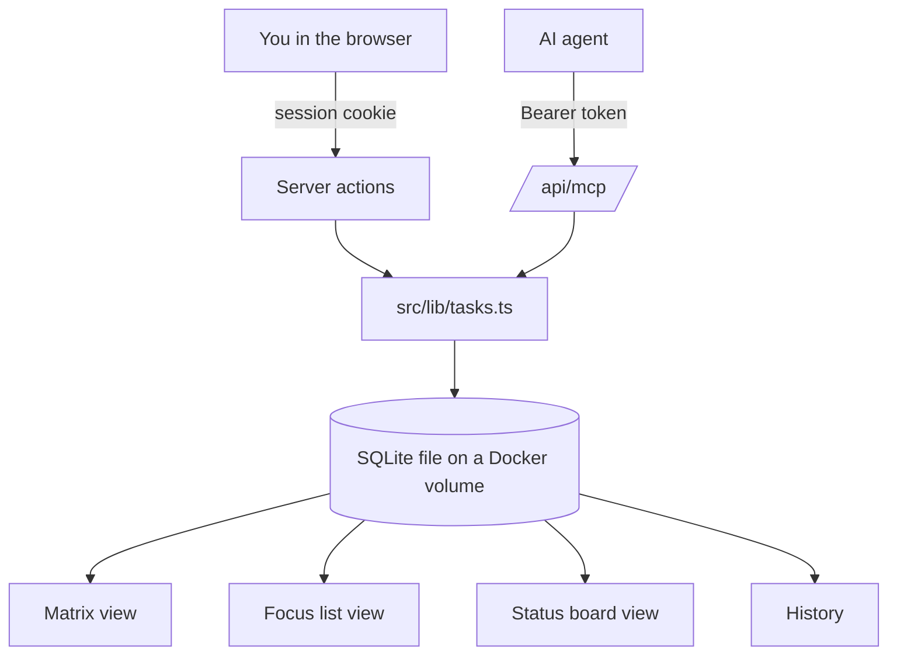

# ODOT

A task planner built on the Eisenhower matrix. Each person gets a private planner, and an AI agent can manage tasks through MCP.



## What it does

- **Three views of the same tasks.** Matrix groups by quadrant. Focus list is a sortable table, grouped by quadrant or flat. Status board groups by to do, in progress and done. Switch with the buttons or the keys 1, 2 and 3. ODOT remembers your choice.
- **Inbox.** Tasks without a quadrant wait here until you or the agent classify them.
- **History.** Every completed task, by year, with a heatmap, streaks and a breakdown by quadrant and tag. You can reopen tasks from here.
- **Repeating tasks.** Completing one creates the next occurrence, so each completion stays in history.
- **Activity log.** Every change records who made it, you or a named agent.
- **Trash.** Deleting is reversible until you empty the trash.
- **Several people.** Admins add accounts. Each person sees only their own tasks.
- **Dark mode** follows the system setting. The layout works on phones.

## Data model

| Field | Values | Notes |
|---|---|---|
| `quadrant` | 1 to 4, or null | null means Inbox |
| `status` | todo, doing, done, dropped | Board columns. done and dropped land in History |
| `priority` | high, medium, low | |
| `area` | work, personal | Top tabs |
| `due_date` | YYYY-MM-DD or null | Calendar date, no time zone |
| `repeat` | daily, weekly, monthly, yearly or null | |
| `created_at`, `started_at`, `completed_at`, `deleted_at` | ISO timestamps | |
| `created_by` | user or agent | |

Tags, the task-to-tag links, users, sessions, API tokens and the activity log each have their own table. The schema and migrations are in `src/lib/db.ts`.

## Run it locally

```bash
npm install
cp .env.example .env.local   # set ODOT_ADMIN_EMAIL and ODOT_ADMIN_PASSWORD
npm run dev                  # http://localhost:3000
```

ODOT creates the first admin from those two variables the first time the database has no users. Change the password in Settings after you sign in.

## Run it with Docker

```bash
cp .env.example .env         # fill in the admin email, password and TZ
docker compose up -d --build
```

Open http://localhost:3000. The database lives in the `odot-data` volume at `/data/odot.db`.

## Deploy to a VPS

1. Install Docker on the VPS and copy this repo there, with `git clone` or `rsync`.
2. Create `.env` from `.env.example`.
3. Run `docker compose up -d --build`.
4. Put HTTPS in front. Compose binds ODOT to `127.0.0.1:3000`, so it can't be reached from outside until you add a reverse proxy. With [Caddy](https://caddyserver.com) on the host, this Caddyfile gets a certificate automatically:

   ```
   odot.example.com {
       reverse_proxy 127.0.0.1:3000
   }
   ```

ODOT marks the login cookie `Secure` when the proxy sends `X-Forwarded-Proto: https`. Caddy sends it by default.

To build on your Mac and ship the image instead, build for the VPS architecture:

```bash
docker buildx build --platform linux/amd64 -t odot:latest --load .
docker save odot:latest | ssh your-vps docker load
```

Then run `docker compose up -d` on the VPS without `--build`.

## Connect an AI agent

1. In ODOT, open Settings, then AI agent access, and create a token. ODOT shows it once.
2. Connect Claude Code:

   ```bash
   claude mcp add --transport http odot https://odot.example.com/api/mcp \
     --header "Authorization: Bearer odot_..."
   ```

   Other MCP clients use the same URL with Streamable HTTP and the same header.

The agent acts as the person who created the token. Its tools are `list_tasks`, `get_task`, `create_task`, `update_task`, `complete_task`, `delete_task` and `list_tags`. The server's instructions explain the quadrants and the Inbox, so a prompt like "classify my inbox" works without extra setup. Revoke a token in Settings to cut off access.

## Back up

```bash
docker compose exec odot node scripts/backup.mjs     # writes /data/backups/odot-<UTC time>.db
docker compose cp odot:/data/backups ./backups
```

The script uses SQLite's `VACUUM INTO`, so the copy stays consistent while ODOT runs. Each person can also download their own data as JSON from Settings.

## Environment variables

| Name | Default | Purpose |
|---|---|---|
| `ODOT_ADMIN_EMAIL`, `ODOT_ADMIN_PASSWORD`, `ODOT_ADMIN_NAME` | none | First admin, created when there are no users |
| `TZ` | UTC | Server time zone. Sets "today" for repeats an agent completes |
| `ODOT_PORT` | 3000 | Host port in docker compose |
| `ODOT_DB_PATH` | `./data/odot.db`, or `/data/odot.db` in Docker | Database file |
| `ODOT_SECURE_COOKIE` | unset | Set to 1 to always mark the cookie Secure |

## Development

```bash
npm test        # date and recurrence tests
npm run lint
npx tsc --noEmit
```

The stack is Next.js 16 with the App Router, React 19, Tailwind 4, Node's built-in `node:sqlite`, zod and the MCP TypeScript SDK. The web UI calls server actions in `src/app/actions`. Agents call `src/app/api/mcp/route.ts`. Both go through `src/lib/tasks.ts`, which validates input and writes the activity log.
