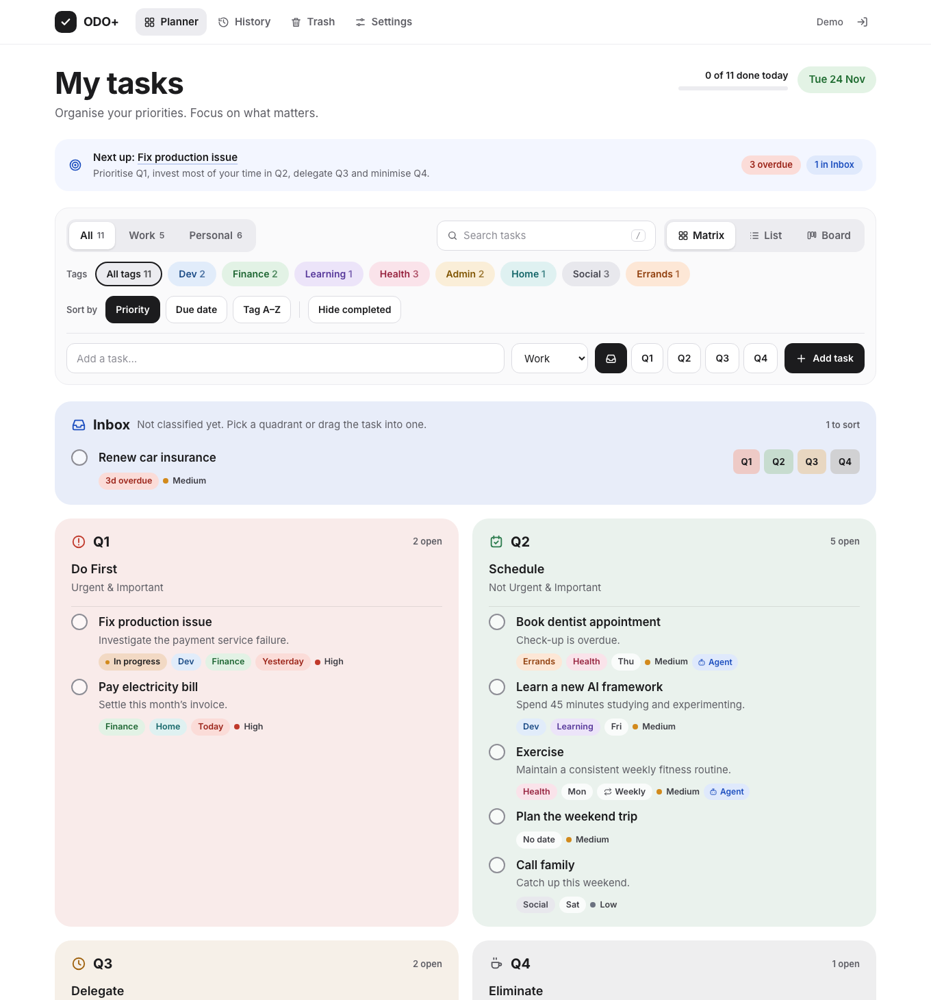
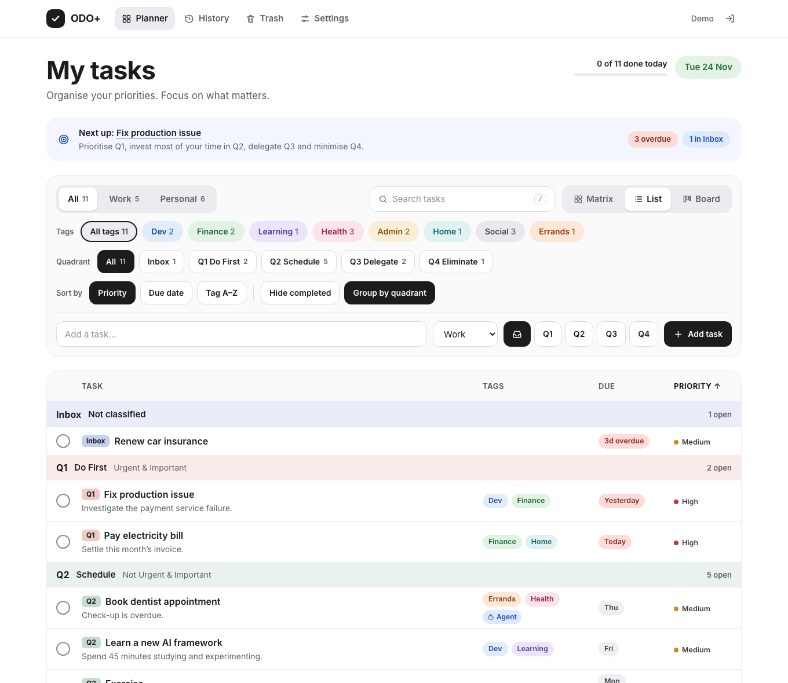
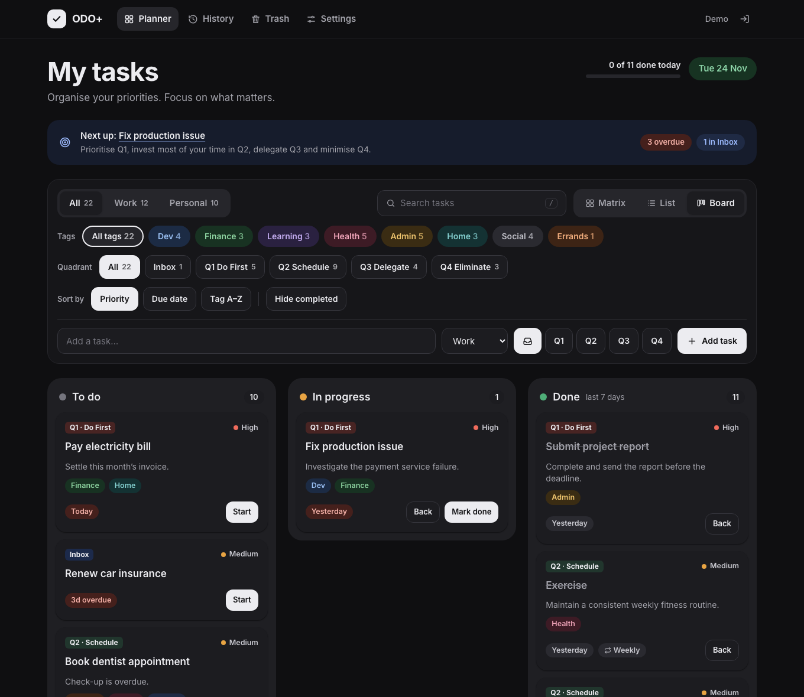
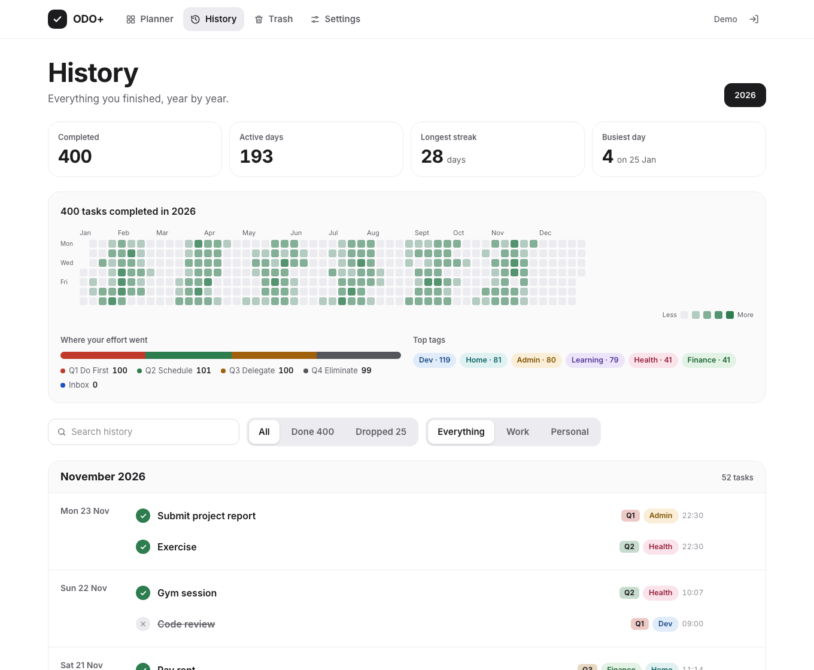
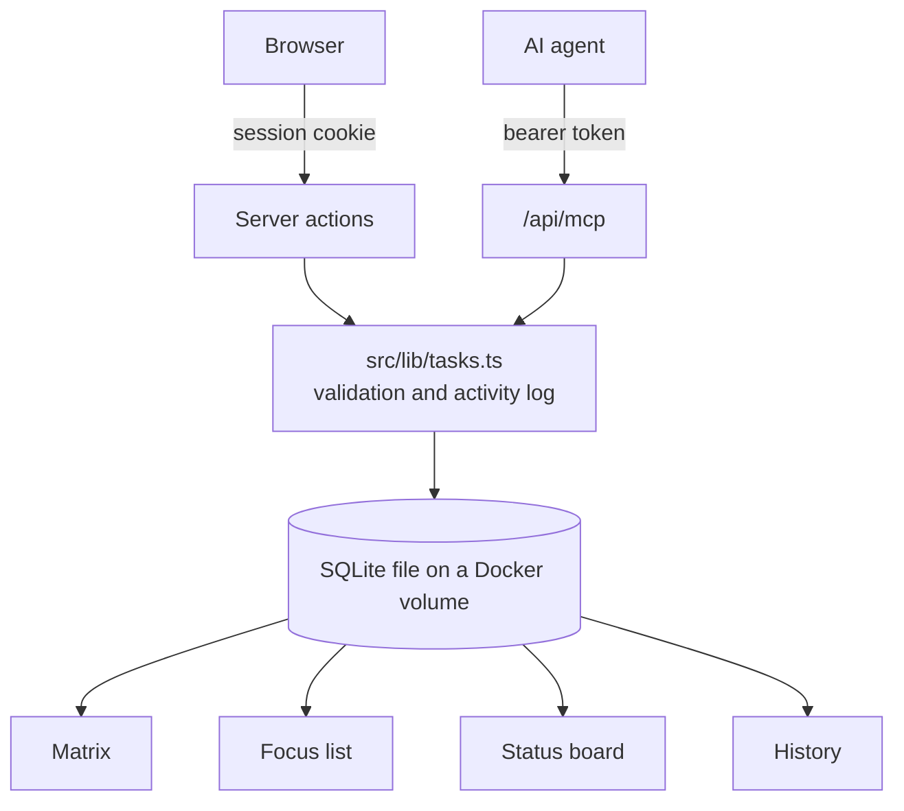

<div align="center">

# ODO+

A self-hosted task planner that uses the Eisenhower matrix. An AI agent can sort and update your tasks through MCP.


[](LICENSE)



</div>

## Contents

- [Features](#features)
- [Screenshots](#screenshots)
- [Quick start](#quick-start)
- [Deploy to a server](#deploy-to-a-server)
- [Connect an AI agent](#connect-an-ai-agent)
- [Configuration](#configuration)
- [Back up and update](#back-up-and-update)
- [How it works](#how-it-works)
- [Development](#development)
- [How to contribute](#how-to-contribute)
- [License](#license)

## Features

- **Three views of one task list.** Matrix groups tasks by quadrant. Focus list is a table that you can sort. Status board groups tasks into To do, In progress and Done.
- **Inbox.** A new task waits in the Inbox until you or the agent give it a quadrant.
- **Areas.** Each person makes up to 8 areas, for example Work and Personal. Each area is a tab, and All shows every area together.
- **History.** ODO+ keeps every finished task. The History page shows each year with a heatmap, streaks, a quadrant breakdown and top tags.
- **Repeat rules.** A task can repeat daily, weekly, monthly or yearly. When you complete it, ODO+ creates the next one.
- **Activity log.** Each task records every change and the name of the person or agent that made it.
- **Trash.** A deleted task goes to the trash. You can restore it until you empty the trash.
- **Several people.** An admin adds accounts. Each person sees only their own tasks.
- **Your look.** Each person sets the quadrant colours and the strength of the tint. Dark mode follows the system setting.
- **Keyboard shortcuts.** Press `n` for a new task and `/` to search. Press `1`, `2` or `3` to change the view.
- **Your data.** Each person can download their data as JSON. The admin can back up the database while ODO+ runs.

## Screenshots

| Focus list | Status board in dark mode |
|---|---|
|  |  |



## Quick start

You need Docker with the Compose plugin.

1. Clone the repository.

   ```bash
   git clone https://github.com/lawaladekunle/myODOT.git
   cd myODOT
   ```

2. Copy the example configuration.

   ```bash
   cp .env.example .env
   ```

3. Open `.env`. Set `ODOT_ADMIN_EMAIL` and `ODOT_ADMIN_PASSWORD`. The password must have 10 or more characters.

4. Start the container.

   ```bash
   docker compose up -d --build
   ```

   Docker builds the image and starts ODO+ on port 3000.

5. Open http://localhost:3000. Sign in with the admin email and password.

   ODO+ creates the admin account when the database has no users.

6. Open **Settings** and change the password.

## Deploy to a server

> [!WARNING]
> Do not open port 3000 to the internet. The login page needs HTTPS. For this reason, the compose file binds ODO+ to `127.0.0.1`.

1. Install Docker Engine and the Compose plugin on the server.
2. Clone the repository on the server.
3. Create `.env` from `.env.example`. Set the admin values and `TZ`.
4. Start ODO+.

   ```bash
   docker compose up -d --build
   ```

   ODO+ listens on `127.0.0.1:3000`. Other computers cannot connect yet.

5. Install [Caddy](https://caddyserver.com) on the server. Put this site in the Caddyfile.

   ```
   odot.example.com {
       reverse_proxy 127.0.0.1:3000
   }
   ```

   Caddy gets a TLS certificate and sends the requests to ODO+.

Caddy sends the `X-Forwarded-Proto: https` header. When ODO+ gets this header, it marks the login cookie `Secure`.

You can also build the image on your own computer and copy it to the server. Set the platform to the architecture of the server.

```bash
docker buildx build --platform linux/amd64 -t odot:latest --load .
docker save odot:latest | ssh your-server docker load
```

Then run `docker compose up -d` on the server, without `--build`.

## Connect an AI agent

ODO+ has an MCP endpoint at `/api/mcp`. The endpoint uses the Streamable HTTP transport and a bearer token.

1. In ODO+, open **Settings**, then **AI agent access**.
2. Type a name for the agent. Select **Create token**.

   ODO+ shows the token one time only. Copy it.

3. Add the server to Claude Code.

   ```bash
   claude mcp add --transport http odot https://odot.example.com/api/mcp \
     --header "Authorization: Bearer odot_..."
   ```

Other MCP clients use the same URL and the same `Authorization` header.

The agent acts for the person who made the token. The activity log shows each change under the token name. To stop the access, revoke the token in **Settings**.

| Tool | What it does |
|---|---|
| `list_tasks` | Finds tasks by status, quadrant, area, tag, text or date. |
| `get_task` | Returns one task and its activity log. |
| `create_task` | Adds a task. A task without a quadrant goes to the Inbox. |
| `update_task` | Changes the fields that you send. |
| `complete_task` | Marks a task done. For a repeat rule, it creates the next task. |
| `delete_task` | Moves a task to the trash. |
| `list_tags` | Returns the tags and their colours. |
| `list_areas` | Returns the areas in tab order. |

The agent can make new tags. It cannot make new areas. If it names an unknown area, ODO+ refuses the change and returns the list of valid areas.

Example requests for the agent:

- "Sort my Inbox into quadrants."
- "Which tasks are overdue? Move the ones that are not important to Q4."
- "Add a weekly task to pay the cleaner, in Personal."

## Configuration

ODO+ reads these values from `.env`.

| Variable | Default | Purpose |
|---|---|---|
| `ODOT_ADMIN_EMAIL` | none | Email of the first admin. |
| `ODOT_ADMIN_PASSWORD` | none | Password of the first admin, with 10 or more characters. |
| `ODOT_ADMIN_NAME` | none | Display name of the first admin. |
| `TZ` | `UTC` in Docker | Time zone of the server. It sets "today" for repeat rules when an agent completes a task. |
| `ODOT_PORT` | `3000` | Port on the host for Docker Compose. |
| `ODOT_DB_PATH` | `/data/odot.db` in Docker | Path of the database file. Outside Docker, the default is `./data/odot.db`. |
| `ODOT_SECURE_COOKIE` | not set | Set to `1` to mark the login cookie `Secure` on all requests. |

ODO+ uses the three admin values only when the database has no users. To change the admin password later, use **Settings**.

## Back up and update

The database is one SQLite file in the `odot-data` Docker volume.

To make a backup, run the backup script. The script uses `VACUUM INTO`, so the copy is correct while ODO+ runs.

```bash
docker compose exec odot node scripts/backup.mjs
docker compose cp odot:/data/backups ./backups
```

The first command writes `/data/backups/odot-<date>-<time>.db` in the container. The second command copies the backups to your computer.

> [!IMPORTANT]
> Make a backup before you update. ODO+ applies database migrations when it opens the database.

To update ODO+, get the new code and build the image again.

```bash
git pull
docker compose up -d --build
```

## How it works



The web pages and the agent use the same rules in `src/lib/tasks.ts`. This file checks all input with zod and writes the activity log.

### Data model

Each task has a quadrant and a status. The three views use these two fields, so a change in one view shows in the other views.

| Field | Values | Notes |
|---|---|---|
| `quadrant` | 1 to 4, or null | Null puts the task in the Inbox. |
| `status` | `todo`, `doing`, `done`, `dropped` | The status board uses this field. Done and dropped tasks go to History. |
| `area_id` | one of the areas of the person | The planner shows one tab for each area. |
| `priority` | `high`, `medium`, `low` | |
| `due_date` | `YYYY-MM-DD` or null | A calendar date without a time zone. |
| `repeat` | `daily`, `weekly`, `monthly`, `yearly` or null | |
| `created_by` | `user` or `agent` | |

`src/lib/db.ts` has the full schema and the migrations.

### Security

- ODO+ stores passwords as scrypt hashes.
- The session cookie is `httpOnly` and `SameSite=Lax`. A session stays valid for 30 days.
- After 10 failed sign-in attempts for one IP address and email, ODO+ blocks that pair for 15 minutes.
- ODO+ stores only a SHA-256 hash of each API token.
- Each person can read and change only their own tasks, from the web pages and from MCP.

### Project structure

```
src/
  app/
    (app)/          Planner, History, Trash and Settings pages
    actions/        Server actions for the web pages
    api/mcp/        MCP endpoint for agents
    api/export/     JSON export
    api/health/     Health check for Docker
    login/          Sign-in page
  components/       Planner views, task drawer and shared parts
  lib/
    tasks.ts        Rules for tasks, tags and areas
    db.ts           SQLite connection and migrations
    auth.ts         Accounts, sessions and API tokens
    colours.ts      Quadrant colour settings
scripts/backup.mjs  Backup with VACUUM INTO
```

## Development

You need Node.js 22.13 or later. ODO+ uses the built-in `node:sqlite` module, and older versions of Node.js 22 load it only with the `--experimental-sqlite` flag.

1. Install the packages.

   ```bash
   npm install
   ```

2. Copy the example configuration to `.env.local`. Set the admin values in that file.

   ```bash
   cp .env.example .env.local
   ```

3. Start the development server.

   ```bash
   npm run dev
   ```

   The server starts on http://localhost:3000 and writes the database to `./data/odot.db`.

Use these commands to check your changes.

```bash
npm test          # date, repeat and colour tests
npm run lint
npx tsc --noEmit
```

The stack is Next.js 16 with the App Router, React 19, Tailwind CSS 4, `node:sqlite`, zod and the MCP TypeScript SDK.

## How to contribute

1. Open an issue that describes the problem or the change.
2. Make a branch from `main`.
3. Run the tests, the linter and the type check.
4. Open a pull request that links to the issue.

## License

You can use, change and share ODO+ under the terms of the MIT License. The full text is in [LICENSE](LICENSE).
